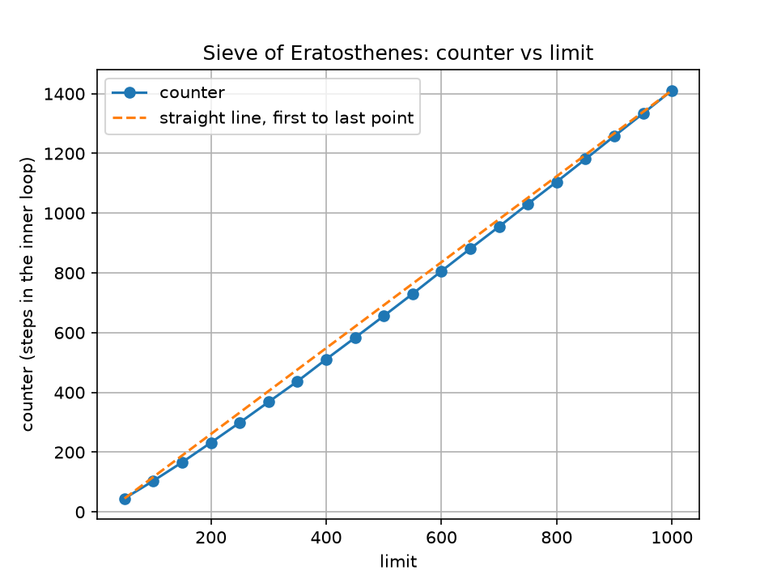

# Lab 1: Sieve of Eratosthenes and the Goldbach conjecture

Three parts: use the Sieve of Eratosthenes to count the primes up to 1000, count how many steps the
sieve takes as the limit grows, and use the sieve to check the Goldbach conjecture for a given even
number.

## Build and run

```bash
javac sieve.java Goldbach.java
java sieve
java Goldbach
python3 plot_counter.py
```

`java sieve` prints the primes and the counter table, and writes the table to `counter_results.csv`.
`plot_counter.py` reads that file and saves `counter_vs_limit.png` (it needs `matplotlib`).

## Part 1: primes up to 1000

With `limit = 1000` the sieve finds **168** prime numbers, the last one being 997.

```
Number of primes up to 1000: 168
```

## Part 2: counting the steps

`counter` is a `public static int` in the `sieve` class and goes up by one every time the innermost
loop crosses out a number. It is reset before each run. With `limit = 100` it comes to 104, the value
the lab gives.

| limit | counter | | limit | counter |
|---|---|---|---|---|
| 50 | 45 | | 550 | 730 |
| 100 | 104 | | 600 | 806 |
| 150 | 166 | | 650 | 881 |
| 200 | 232 | | 700 | 955 |
| 250 | 299 | | 750 | 1031 |
| 300 | 368 | | 800 | 1105 |
| 350 | 437 | | 850 | 1181 |
| 400 | 511 | | 900 | 1258 |
| 450 | 583 | | 950 | 1334 |
| 500 | 656 | | 1000 | 1411 |



At first glance the graph looks like a straight line, but it is a curve that bends slightly upwards.
The dashed line joins the first and last points and every point in between sits below it. The steps
per unit of limit also keep rising: 45 / 50 = 0.90 at the start, 104 / 100 = 1.04, and 1411 / 1000 =
1.41 at the end, where a straight line through the origin would keep that ratio constant. So the
counter grows a little faster than a line, but far slower than something like n². This fits the
sieve's complexity of O(n log log n): each prime p crosses out about n / p numbers, and the extra
log log n factor grows so slowly that the curve is nearly linear.

## Part 3: Goldbach conjecture

`Goldbach.java` reads an even number n greater than 2, builds the sieve up to n and looks for the
first prime p where n − p is also prime. It prints that one pair, then checks that every even number
from 4 up to n has a pair as well.

```
Please input an even number greater than 2: 14
14 = 3 + 11
The conjecture holds for every even number from 4 to 14
```

### Tests run

| Input | Output | Checks |
|---|---|---|
| 14 | `14 = 3 + 11` | example from the lab |
| 4 | `4 = 2 + 2` | smallest valid input, both primes the same |
| 20 | `20 = 3 + 17` | one of the two sums in the lab |
| 42 | `42 = 5 + 37` | one of the three sums in the lab |
| 1000 | `1000 = 3 + 997` | every even number from 4 to 1000 also holds |
| 100000 | `100000 = 11 + 99989` | every even number from 4 to 100000 also holds |
| 7, 2, 0, -6 | `... is not an even number greater than 2` | odd, too small and negative input |

## Notes

- One solution is printed per number: the pair with the smallest first prime.
- `Goldbach.java` uses the sieve method from `sieve.java`, so both files need to be compiled.
