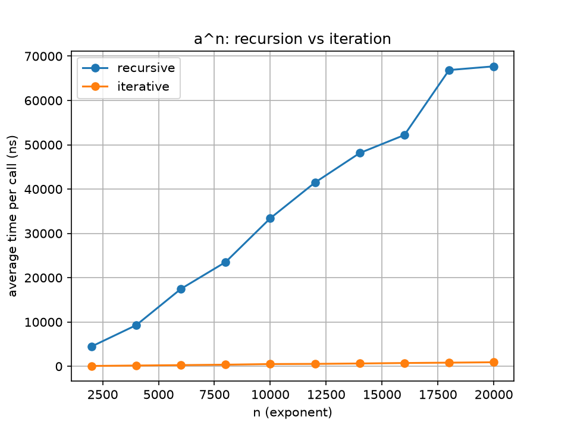

# Recursion

Four recursive methods: the sum of the first n natural numbers, reversing a string, checking for a
palindrome, and a power function that is also written with a loop so the two can be timed against
each other.

## Build and run

```bash
javac *.java
java SumNatural
java ReverseString
java PalindromeRecursive
java Power
python3 plot_power.py
```

`java Power` writes its timing table to `power_timing.csv`, and `plot_power.py` turns that into
`power_timing.png` (it needs `matplotlib`).

## Task 1: sum of the first n natural numbers

`sum(n)` returns `n + sum(n - 1)`, with `sum(0) = 0` as the base case. The program prints the formula
n(n + 1) / 2 beside it as a check.

```
Please input a number: 10
Sum of 1 to 10 = 55
Formula n(n+1)/2 = 55
```

| Input | Recursive sum | Formula |
|---|---|---|
| 10 | 55 | 55 |
| 1 | 1 | 1 |
| 0 | 0 | 0 |
| 100 | 5050 | 5050 |
| 10000 | 50005000 | 50005000 |
| -5 | `The number can't be negative` | |

## Task 2: reverse a string

`reverse(s)` reverses everything after the first character and adds the first character to the end.

```
Please input a string: Hello World
Reversed: dlroW olleH
```

Also run with `abc` (`cba`), `racecar` (`racecar`), a single character and an empty line, which both
come back unchanged.

## Task 3: palindrome

`isPalindrome(s)` compares the first and last characters and then calls itself on the string between
them. A string of length 0 or 1 is the base case.

| Input | Result |
|---|---|
| `madam`, `racecar`, `noon`, `aa`, `a`, empty | palindrome |
| `hello`, `ab`, `abca` | not a palindrome |
| `Madam` | not a palindrome, the comparison is case sensitive |

## Task 4: power, recursion against iteration

`powerRecursive` and `powerIterative` keep the signatures from the lab, and `main` starts with
the lab's timing code for a = 2, n = 20000:

```
2^10: recursive 1024, iterative 1024
3^13: recursive 1594323, iterative 1594323
7^0:  recursive 1, iterative 1

Recursive time: 247916 ns
Iterative time: 85334 ns
```

Those two times are for a single first call of each method. For a steadier comparison the program
then calls each version 2000 times for every n and takes the average:

| n | Recursive (ns) | Iterative (ns) |
|---|---|---|
| 2000 | 4473 | 89 |
| 4000 | 9291 | 182 |
| 6000 | 17475 | 275 |
| 8000 | 23532 | 372 |
| 10000 | 33414 | 515 |
| 12000 | 41478 | 552 |
| 14000 | 48131 | 645 |
| 16000 | 52198 | 749 |
| 18000 | 66867 | 831 |
| 20000 | 67701 | 922 |

Measured on an Apple M3 laptop (8 GB) with OpenJDK 25. The numbers change from run to run.



Both versions do n multiplications and both grow in a straight line with n, so they are both O(n),
but the recursive one is a lot slower at every size (between 50 and 75 times here). Each recursive step is a
method call that has to set up a stack frame and return through it, while the loop just updates one
variable, and a simple loop like this is also much easier for the JVM to optimise. The gap is far
bigger in the averaged table than in the single calls at the top for that reason.

The other difference is memory. The recursive version needs all n calls on the stack at once. The
program doubles n until that fails:

```
n = 20000: recursive ok
n = 40000: recursive ok
n = 80000: recursive ok
n = 160000: recursive StackOverflowError
n = 160000: iterative ok
```

So with the default stack size the recursion fails somewhere between 80,000 and 160,000 calls, while
the loop has no limit. The exact point depends on the JVM and its stack size setting (`-Xss`).
`SumNatural` has the same limit: with 65535 as input it also ended in a `StackOverflowError`.

## Notes

- 2^20000 is far too big for a `long`, which only holds values up to 2^63 − 1. After 64
  multiplications by 2 every bit has been shifted out and the result is 0, so for large n both
  methods return 0. This doesn't affect the timing, which is what the task is about, and the small
  cases at the top of the output show both methods give correct answers when the result fits.
- Negative exponents aren't handled, since the result would not be a whole number.
