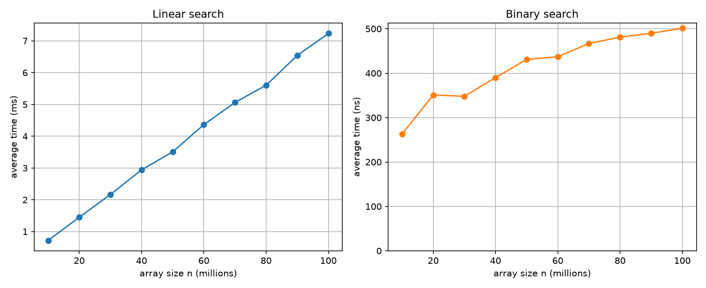

# Working with arrays

Three tasks: check whether an array is a palindrome, time linear search against binary search as the
array grows, and check whether a square of numbers typed in by the user is a magic square.

## Build and run

```bash
javac *.java
java ArrayPalindrome
java arraysearch
java MagicSquare
python3 plot_search.py
```

`java arraysearch` writes its timing table to `search_timing.csv`, and `plot_search.py` turns that
into `search_timing.png` (it needs `matplotlib`). The largest array is 100 million `int`s, about
400 MB, so the program needs that much heap available.

## Task 1: array palindrome

`isPalindrome` compares the first element with the last, the second with the second last and so on,
stopping at the first pair that differs. There is a version for `int[]` and one for `char[]`, since a
string is an array of characters. The arrays are set up in the code.

```
1 2 3 2 1 is palindrome
1 2 3 1 2 is not palindrome
4 7 7 4 is palindrome
9 is palindrome
is palindrome
radar is palindrome
madam is palindrome
array is not palindrome
```

The fifth line is the empty array, which counts as a palindrome.

## Task 2: linear and binary search

The array of size n holds 0 to n − 1 in order, so it is always sorted. The target is
`rand.nextInt(n)`, which is always a value in the array. One search of each kind on 100 million
elements:

```
Linear search: found 67447701 at index 67447701
Execution time: 12 ms
Binary search: found 67447701 at index 67447701
Execution time: 0 ms (5042 ns)
```

A single binary search is far below one millisecond, so for the table the times are averages: 200
linear searches and 100,000 binary searches per array size, each for a different random target.
Linear search is given in milliseconds and binary search in nanoseconds.

| n | Linear search (ms) | Binary search (ns) |
|---|---|---|
| 10,000,000 | 0.719 | 263 |
| 20,000,000 | 1.451 | 351 |
| 30,000,000 | 2.165 | 348 |
| 40,000,000 | 2.941 | 390 |
| 50,000,000 | 3.508 | 431 |
| 60,000,000 | 4.364 | 437 |
| 70,000,000 | 5.062 | 467 |
| 80,000,000 | 5.603 | 481 |
| 90,000,000 | 6.541 | 490 |
| 100,000,000 | 7.235 | 501 |

Measured on an Apple M3 laptop (8 GB) with OpenJDK 25. The numbers change from run to run and from
machine to machine, but the shapes stay the same.



Binary search is much faster: at n = 100 million it takes about 0.0005 ms against 7.2 ms, roughly
14,000 times quicker. The linear search graph is a straight line, ten times the array takes ten times
as long, which is what O(n) predicts since a random target is on average half way along. The binary
search graph rises quickly at first and then flattens out, the shape of a log curve: going from 10 to
100 million only adds 3 or 4 halving steps to the 23 or so already needed, and the time doesn't even
double. This is what
I expected from O(log n). The binary search times are also higher than the step count alone would
suggest, because each step jumps to a far away part of a very large array.

## Task 3: magic square

The program asks for the size n, then for each number one at a time, prints the square back and says
whether it is magic. `isMagic` takes the sum of the first row as the target and compares every row,
every column and both diagonals with it.

### Sample run

This is the lab's example, and the output matches it line for line.

```
Enter size of matrix (n): 3
Enter matrix elements:
Enter Element at row 1, column 1
1
Enter Element at row 1, column 2
5
Enter Element at row 1, column 3
4
Enter Element at row 2, column 1
2
Enter Element at row 2, column 2
6
Enter Element at row 2, column 3
3
Enter Element at row 3, column 1
1
Enter Element at row 3, column 2
2
Enter Element at row 3, column 3
6
You entered:
1 5 4 
2 6 3 
1 2 6 

The square is NOT a magic square!
```

### Tests run

| Square | Result | Checks |
|---|---|---|
| `1 5 4 / 2 6 3 / 1 2 6` | NOT a magic square | sample from the lab |
| `2 7 6 / 9 5 1 / 4 3 8` | magic square | the lab's 3×3 example, sum 15 |
| `1 14 14 4 / 11 7 6 9 / 8 10 10 5 / 13 2 3 15` | magic square | the 4×4 Sagrada Familia square, sum 33 |
| `5` | magic square | 1×1 |
| `1 1 / 1 1` | magic square | all values equal |
| `1 2 3 / 4 5 6 / 7 8 9` | NOT a magic square | rows differ |
| `2 7 6 / 9 5 1 / 4 8 3` | NOT a magic square | rows all 15 but columns and a diagonal differ |
| size `0` | `The size must be at least 1` | invalid size |

## Notes

- `arraysearch.java` sets up an array of size `n` filled with increasing integers, and the two search
  methods are the standard ones.
- A square that is magic prints `The square is a magic square!`.
- A magic square here is any square where all the sums are equal. The
  numbers don't have to be different (the Sagrada Familia square repeats 10 and 14).
